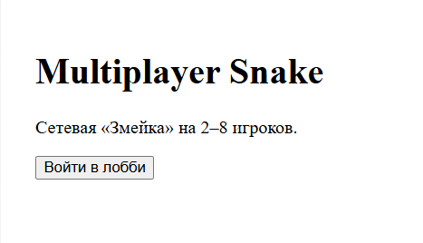
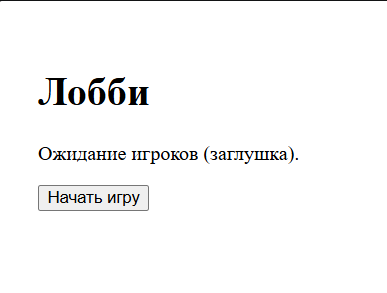

# Multiplayer Snake

Мультиплеерная «Змейка» с сетевой игрой на 2–8 игроков. Настольное браузерное приложение.

## Стек

- React 19 + TypeScript
- Vite
- React Router
- Vitest + Testing Library
- ESLint
- npm workspaces (монорепо)

## Структура
apps/client — основное приложение
packages/shared-ui — библиотека общих компонентов

## Установка

npm install

## Запуск

npm run dev

## Сборка

npm run build

## Линтинг (в каждом проекте)

npm run lint
npm run lint:fix

## Тесты

npm run test
npm run test:coverage -w packages/shared-ui

Для разработки библиотеки компонентов в режиме проверки изменений:

npm run dev -w packages/shared-ui

## Cкриншоты

### Главная страница

### Лобби

### Игра
