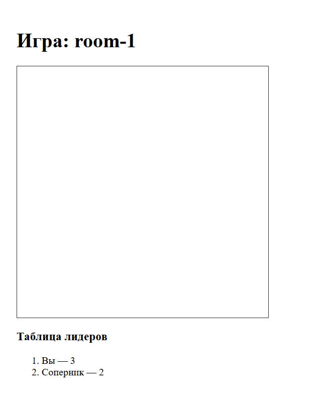

# Multiplayer Snake

Мультиплеерная «Змейка» с сетевой игрой на 2–8 игроков. Настольное браузерное приложение.

## Стек

- React 19 + TypeScript
- Vite
- React Router
- Сервер авторитетной игровой логики на Node.js (MVP)
- WebSocket (`ws`) и общие типы клиент-серверного протокола
- Vitest + Testing Library
- ESLint
- npm workspaces (монорепо)

## Структура
- `apps/client` — основное приложение
- `apps/server` — авторитетный игровой сервер (MVP)
- `packages/shared-ui` — библиотека общих компонентов
- `packages/shared-types` — общий WebSocket-протокол и типы состояния

## Установка

npm install

## Запуск

Запустите клиент и сервер в отдельных терминалах:

```sh
npm run dev
npm run dev:server
```

Сервер принимает WebSocket-соединения по `ws://localhost:3000/ws`; для
проверки доступности откройте `http://localhost:3000/health`.

## Сборка

npm run build

## Линтинг

npm run lint
npm run lint:fix

## Тесты

npm run test
npm run test:coverage

Для разработки библиотеки компонентов в режиме проверки изменений:

npm run dev -w packages/shared-ui

## Cкриншоты

### Главная страница


### Лобби


### Игра
